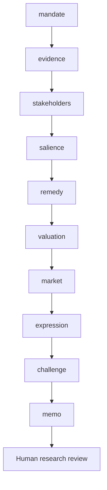

# Workflow

Who may be harmed across the value chain, how severe is the risk, and what prevention, remedy and investment responses are evidenced?

Routes: `issuer-diligence`, `supply-chain-review`, `remediation-review`. These named use cases share a sequential evidence/review core; they are not separately calibrated financial models.

| Step | Research task | Stage ID |
|---|---|---|
| 1 | Mandate and investable decision | `mandate` |
| 2 | Evidence intake and reconciliation | `evidence` |
| 3 | People and value-chain mapping | `stakeholders` |
| 4 | Salience, severity and evidence | `salience` |
| 5 | Prevention, leverage and remedy | `remedy` |
| 6 | Operational economics and financial transmission | `valuation` |
| 7 | Market context and implementation evidence | `market` |
| 8 | Investment-decision handoff | `expression` |
| 9 | Independent challenge and exceptions | `challenge` |
| 10 | Investment committee and accountable review | `memo` |

A COMPLETE artifact is structurally complete, not certified correct. Material gaps stop dependencies. Open MATERIAL/CRITICAL issues block research approval. A source-study intentionally stops after the evidence stage.
